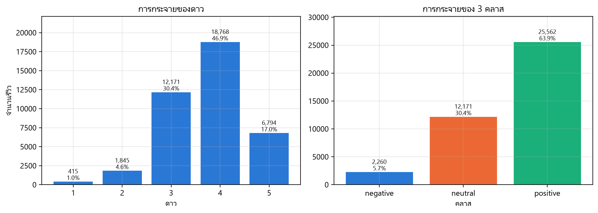
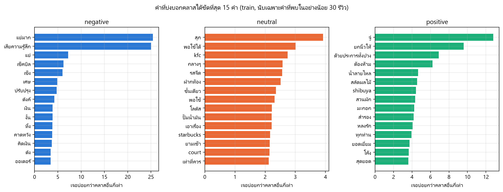

# Thai Review Sentiment: Embeddings + PCA

How well do Thai text embeddings predict restaurant review sentiment, and how far can PCA
shrink those embeddings before performance drops?

Sentence embeddings are 1024 floats per review. That is fine for 40,000 reviews and expensive
for a few million, so the practical question is not only "does it work" but "how small can the
vectors get while still working". This repo measures both on 39,993 real Thai restaurant reviews.

> **Status:** data pipeline and EDA are done. Embeddings, models and PCA results are not in yet,
> so the results section below is still empty. Nothing here is estimated or placeholder — numbers
> appear only once they have been measured.

## Data

[Wongnai review corpus](https://github.com/wongnai/wongnai-corpus) — `w_review_train.csv`,
40,000 Thai restaurant reviews with a 1-5 star rating. The companion `test_file.csv` has no
labels and is ignored.

After dropping 7 duplicate rows: **39,993 reviews**, mapped to three classes.

| | negative (1-2★) | neutral (3★) | positive (4-5★) |
|---|---|---|---|
| reviews | 2,260 | 12,171 | 25,562 |
| share | 5.7% | 30.4% | 63.9% |

Split 70/15/15 stratified on the star rating, seed 42 → 27,995 / 5,999 / 5,999, with identical
class shares in each split. The test split is only touched for the final numbers.

The classes are heavily imbalanced: always answering `positive` already scores 63.9% accuracy.
**Macro-F1 is therefore the primary metric**, and `class_weight="balanced"` is used wherever the
model supports it.



## What the EDA found

Full notebook: [`notebooks/01_eda.ipynb`](notebooks/01_eda.ipynb)

**Reviews are short enough for a 512-token window.** Median 116 bge-m3 tokens, p95 437,
max 6,071. Only **3.55%** of reviews get truncated at `max_length=512`, spread evenly across
classes (3.98% / 2.87% / 3.83%), so truncation does not bias any one class.

**The most frequent words are almost the same in all three classes.** `ร้าน`, `อร่อย`, `ดี`,
`รสชาติ`, `ทาน` rank near the top everywhere. Counting words barely separates sentiment.

**Negation is the interesting failure.** The word `อร่อย` ("tasty") appears in **50% of negative
reviews** against 69% of positive ones. The reason: 16% of negative reviews contain `ไม่อร่อย`
("not tasty"), but the `newmm` tokenizer splits that into `ไม่` + `อร่อย` and `ไม่` is a stopword.
A bag of words keeps the positive token and throws the negation away. This is the main reason to
expect sentence embeddings to beat TF-IDF here.

**Neutral has no vocabulary of its own.** Ranking words by how much more often they appear in one
class than the others, negative is marked by complaints (`แย่มาก`, `เสียความรู้สึก`, `เซ็ง`) and
positive by praise (`ยกนิ้วให้`, `ยอดเยี่ยม`, `สุดยอด`) — but neutral is marked by hedging
(`พอใช้ได้`, `กลางๆ`, `เท่าที่ควร`). It sits between the other two rather than forming its own
cluster, so it should be the hardest class.



## Method

| Stage | Choice |
|---|---|
| Cleaning | Light: strip URLs, collapse 4+ repeated characters, normalize with `pythainlp` |
| Baseline features | TF-IDF over `newmm` tokens, bigrams, fit on train only |
| Main features | `BAAI/bge-m3` dense embeddings, 1024 dims, fp16, L2-normalized |
| Models | Logistic Regression, Linear SVM, kNN (cosine), LightGBM |
| Dimensionality reduction | PCA fit on train only, then applied to val/test |
| PCA dims | 1024 (none), 512, 256, 128, 64, 32, 16 |
| Tuning | Small grid on the validation split only |
| Metrics | Macro-F1 (primary), accuracy, per-class F1, train/predict time, vector size in MB |

Embeddings are computed once and cached to `data/embeddings/*.npy`; every later step loads them
from disk rather than recomputing. That gives 2 TF-IDF baseline runs plus 4 models × 7 dims =
28 embedding runs, each appended as one row to `results/metrics.csv`.

## Results

Not measured yet. This section will hold the model comparison, the macro-F1 vs dimensions curve,
the explained-variance plot and the point where PCA stops being free.

Every number published here will come from `results/metrics.csv`.

## Reproducing

Requires Python 3.11 and, for the embedding step, an NVIDIA GPU. Developed on an RTX 3060 laptop
(6 GB VRAM) on Windows.

```powershell
py -3.11 -m venv .venv
.venv\Scripts\Activate.ps1

# CUDA build of PyTorch, from the official index
pip install torch --index-url https://download.pytorch.org/whl/cu126
pip install -r requirements.txt

python -c "import torch; print(torch.cuda.is_available())"   # expect True
```

Then run the pipeline from the repo root:

```powershell
python -m src.data        # download, clean, split -> data/processed/*.parquet
python -m src.features    # TF-IDF + bge-m3 embeddings                (not written yet)
python -m src.train       # models x PCA dims -> results/metrics.csv  (not written yet)
```

`src/data.py` downloads the dataset on first run and skips the download if the raw file is
already present. `src/features.py` will skip any `.npy` file that already exists, so re-running
the pipeline does not recompute embeddings.

Only the embedding step needs a GPU; everything after it is CPU-only. A Colab notebook that runs
the same embedding code and writes the `.npy` files to Google Drive is planned as a fallback for
machines without CUDA.

## Layout

```
data/                raw, processed and cached embeddings (gitignored)
notebooks/
  01_eda.ipynb       exploratory analysis and the figures above
src/
  config.py          seed, paths, label map, PCA dims, model list
  data.py            download, clean, split
  plotting.py        shared matplotlib setup, Thai font, figure saving
  features.py        TF-IDF + embeddings                 (not written yet)
  train.py           train/eval loop over models x dims  (not written yet)
  evaluate.py        metrics, timing, confusion matrix   (not written yet)
results/
  metrics.csv        one row per (feature, dims, model)  (not created yet)
  figures/
report/figures/      same figures, for the written report
```

All settings live in `src/config.py`. Scripts run as modules from the repo root.

## Context

Final assignment for a Data Science course at KMITL. The written report is in Thai and is not
part of this repository.

Planned next: load the embeddings into a vector database for semantic search over the reviews,
and reuse the PCA sweep to measure recall@k against vector size.
