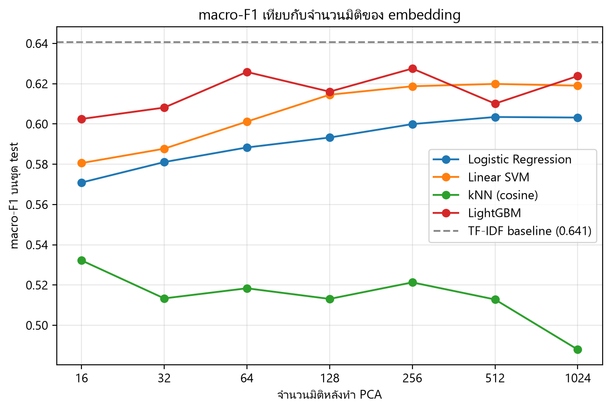
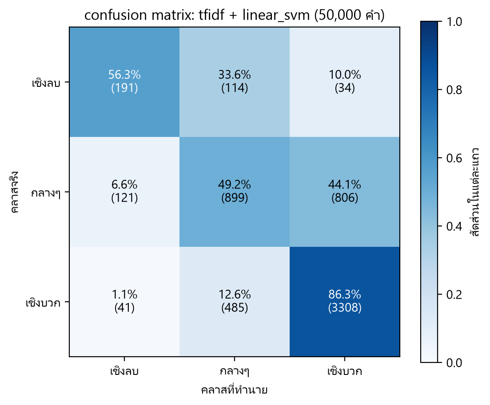

# Thai Review Sentiment: Embeddings + PCA

How well do Thai text embeddings predict restaurant review sentiment, and how far can PCA
shrink those embeddings before performance drops?

Sentence embeddings are 1024 floats per review. That is fine for 40,000 reviews and expensive
for a few million, so the practical question is not only "does it work" but "how small can the
vectors get while still working". This repo measures both on 39,993 real Thai restaurant reviews.

**Short answer:** a TF-IDF baseline wins, and PCA is close to free. The best model is a linear
SVM on TF-IDF bigrams at **0.641 macro-F1**; the best embedding model reaches **0.628**. PCA can
cut bge-m3 from 1024 to 64 dimensions — 6% of the storage — and LightGBM gets *slightly better*
rather than worse.

## Data

[Wongnai review corpus](https://github.com/wongnai/wongnai-corpus) — `w_review_train.csv`,
40,000 Thai restaurant reviews with a 1-5 star rating. The companion `test_file.csv` has no
labels and is ignored.

After dropping 7 duplicate rows: **39,993 reviews**, mapped to three classes.

| | negative (1-2★) | neutral (3★) | positive (4-5★) |
|---|---|---|---|
| reviews | 2,260 | 12,171 | 25,562 |
| share | 5.7% | 30.4% | 63.9% |

Split 70/15/15 stratified on the star rating, seed 42 → 27,995 / 5,999 / 5,999, with identical
class shares in each split. The test split is only touched for the final numbers.

The classes are heavily imbalanced: always answering `positive` already scores 63.9% accuracy.
**Macro-F1 is therefore the primary metric**, and `class_weight="balanced"` is used wherever the
model supports it.


## What the EDA found

Full notebook: [`notebooks/01_eda.ipynb`](notebooks/01_eda.ipynb)

**Reviews are short enough for a 512-token window.** Median 116 bge-m3 tokens, p95 437,
max 6,071. Only **3.55%** of reviews get truncated at `max_length=512`, spread evenly across
classes (3.98% / 2.87% / 3.83%), so truncation does not bias any one class.

**The most frequent words are almost the same in all three classes.** `ร้าน`, `อร่อย`, `ดี`,
`รสชาติ`, `ทาน` rank near the top everywhere. Counting words barely separates sentiment.

**Negation is the interesting failure.** The word `อร่อย` ("tasty") appears in **50% of negative
reviews** against 69% of positive ones. The reason: 16% of negative reviews contain `ไม่อร่อย`
("not tasty"), but the `newmm` tokenizer splits that into `ไม่` + `อร่อย` and `ไม่` is a stopword.
A bag of words keeps the positive token and throws the negation away. This was the main reason to
expect sentence embeddings to beat TF-IDF here.

That expectation turned out to be wrong, and the fix was cheaper than embeddings: the TF-IDF
baseline keeps stopwords and uses bigrams, so `ไม่ อร่อย` survives as a single feature. See
[Results](#results).

**Neutral has no vocabulary of its own.** Ranking words by how much more often they appear in one
class than the others, negative is marked by complaints (`แย่มาก`, `เสียความรู้สึก`, `เซ็ง`) and
positive by praise (`ยกนิ้วให้`, `ยอดเยี่ยม`, `สุดยอด`) — but neutral is marked by hedging
(`พอใช้ได้`, `กลางๆ`, `เท่าที่ควร`). It sits between the other two rather than forming its own
cluster, so it should be the hardest class.


## Method

| Stage | Choice |
|---|---|
| Cleaning | Light: strip URLs, collapse 4+ repeated characters, normalize with `pythainlp` |
| Baseline features | TF-IDF over `newmm` tokens, bigrams, fit on train only |
| Main features | `BAAI/bge-m3` dense embeddings, 1024 dims, fp16, L2-normalized |
| Models | Logistic Regression, Linear SVM, kNN (cosine), LightGBM |
| Dimensionality reduction | PCA fit on train only, then applied to val/test |
| PCA dims | 1024 (none), 512, 256, 128, 64, 32, 16 |
| Tuning | Small grid on the validation split only |
| Metrics | Macro-F1 (primary), accuracy, per-class F1, train/predict time, vector size in MB |

Embeddings are computed once and cached to `data/embeddings/*.npy`; every later step loads them
from disk rather than recomputing. That gives 2 TF-IDF baseline runs plus 4 models × 7 dims =
28 embedding runs, each appended as one row to `results/metrics.csv`.

## Results

All 30 runs are in [`results/metrics.csv`](results/metrics.csv); every number below is read from
that file. Analysis notebook: [`notebooks/02_results.ipynb`](notebooks/02_results.ipynb).

### TF-IDF beats bge-m3

| Features | Model | Macro-F1 | Accuracy | F1 neg | F1 neu | F1 pos |
|---|---|---|---|---|---|---|
| TF-IDF | Linear SVM | **0.641** | 0.733 | 0.552 | 0.541 | 0.829 |
| TF-IDF | Logistic Regression | 0.631 | 0.708 | 0.527 | 0.566 | 0.801 |
| bge-m3 (256d) | LightGBM | 0.628 | 0.698 | 0.567 | 0.522 | 0.793 |
| bge-m3 (1024d) | LightGBM | 0.624 | 0.697 | 0.566 | 0.510 | 0.795 |
| bge-m3 (1024d) | Linear SVM | 0.619 | 0.710 | 0.534 | 0.509 | 0.815 |
| bge-m3 (1024d) | Logistic Regression | 0.603 | 0.678 | 0.503 | 0.525 | 0.782 |
| bge-m3 (1024d) | kNN (cosine) | 0.488 | 0.670 | 0.359 | 0.310 | 0.795 |

Neutral is the weakest class for every model (F1 0.51-0.57), exactly as the EDA predicted.
Embeddings do beat TF-IDF on the *negative* class (0.567 vs 0.552) — they just lose more on
neutral and positive.

Two things explain the gap. bge-m3 is trained for *retrieval* — finding documents about the same
topic — not for sentiment, which the nearest-neighbour check makes obvious: the closest review to
a negative dessert-shop review is a positive dessert-shop review. And the negation problem that
motivated embeddings is already solved on the baseline side by keeping stopwords and using
bigrams, so `ไม่ อร่อย` stays intact.

### PCA is nearly free, and sometimes helps



90% of the variance fits in **281 of 1024 components**, 95% in 374.

| Model | F1 @1024 | Best cheap dims | F1 there | Δ | Storage left |
|---|---|---|---|---|---|
| LightGBM | 0.624 | **64** | 0.626 | **+0.002** | 6.3% |
| Linear SVM | 0.619 | 128 | 0.615 | -0.005 | 12.5% |
| Logistic Regression | 0.603 | 128 | 0.593 | -0.010 | 12.5% |
| kNN (cosine) | 0.488 | 16 | 0.532 | **+0.044** | 1.6% |

LightGBM at 64 dimensions slightly *beats* the full 1024 — dropping the low-variance tail removes
noise. kNN improves monotonically as dimensions fall, a textbook case of the curse of
dimensionality: in 1024 dimensions all pairwise distances converge and neighbourhoods stop
meaning anything.

### Almost every error is the neutral boundary



1,601 of 5,999 test reviews are misclassified (26.7%). **95% of those errors involve the neutral
class**, and negative↔positive confusion accounts for only 75 cases (4.7%).

| True → predicted | Count |
|---|---|
| neutral → positive | 806 |
| positive → neutral | 485 |
| neutral → negative | 121 |
| negative → neutral | 114 |
| positive → negative | 41 |
| negative → positive | 34 |

The model gets the *direction* of sentiment right and fails on *where to draw the line*. The
examples bear this out: 3-star reviews whose text is pure praise ("รสชาติโดยรวมโอเคค่ะ ราคาก้อไม่แพง")
and 4-star reviews that mix praise with a complaint. This is ambiguity in the labels, not a
modelling failure — a human reading the text alone would not recover the star rating either.

## Reproducing

Requires Python 3.11 and, for the embedding step, an NVIDIA GPU. Developed on an RTX 3060 laptop
(6 GB VRAM) on Windows.

```powershell
py -3.11 -m venv .venv
.venv\Scripts\Activate.ps1

# CUDA build of PyTorch, from the official index
pip install torch==2.14.1 --index-url https://download.pytorch.org/whl/cu126
pip install -r requirements.txt

python -c "import torch; print(torch.cuda.is_available())"   # expect True
```

Then run the pipeline from the repo root:

```powershell
python -m src.data        # download, clean, split -> data/processed/*.parquet
python -m src.features    # newmm tokens + bge-m3 embeddings -> data/embeddings/*.npy
python -m src.train       # models x PCA dims -> results/metrics.csv
```

Then run [`notebooks/02_results.ipynb`](notebooks/02_results.ipynb) for the figures and the error
analysis.

`src/data.py` downloads the dataset on first run and skips the download if the raw file is
already present. `src/features.py` will skip any `.npy` file that already exists, so re-running
the pipeline does not recompute embeddings.

Embedding all 39,993 reviews takes about 4.5 minutes on an RTX 3060; the full 28-run sweep is
roughly 15 minutes on CPU. Only the embedding step needs a GPU.

If `huggingface.co` is unreachable, `tools/fetch_bge_m3.py` mirrors the weights from ModelScope
into `data/models/bge-m3` (checksum-verified, resumable) and `src/features.py` picks that folder
up automatically. [`notebooks/embed_colab.ipynb`](notebooks/embed_colab.ipynb) is a second
fallback that produces the same `.npy` files on a Colab T4.

## Layout

```
data/                raw, processed and cached embeddings (gitignored)
notebooks/
  01_eda.ipynb       exploratory analysis and the figures above
  02_results.ipynb   model comparison, PCA sweep, error analysis
  embed_colab.ipynb  fallback embedding run for machines without CUDA
src/
  config.py          seed, paths, label map, PCA dims, model list, grids
  data.py            download, clean, split
  plotting.py        shared matplotlib setup, Thai font, figure saving
  features.py        newmm tokens, TF-IDF, bge-m3 embeddings
  train.py           train/eval loop over models x dims
  evaluate.py        model factory, metrics, confusion matrix
results/
  metrics.csv        one row per (feature, dims, model), 30 rows
  figures/
report/figures/      same figures, for the written report
```

All settings live in `src/config.py`. Scripts run as modules from the repo root.

## Context

Final assignment for a Data Science course at KMITL. The written report is in Thai and is not
part of this repository.

Planned next: load the embeddings into a vector database for semantic search over the reviews,
and reuse the PCA sweep to measure recall@k against vector size.
